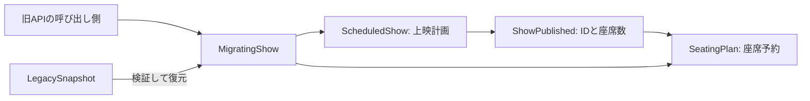

# Rustで考えるDomain-Driven Transformation

映画館の上映計画と座席予約を題材に、共通モデルを分け、旧APIを残しながらデータを引き継ぐ例です。書籍のコードをそのまま移植したものではありません。

- 書籍：[Domain-Driven Transformation](https://www.oreilly.co.jp/books/9784814401727/)
- 読書感想文：[Domain-Driven Transformation](../../blogs/contents/domain-driven-transformation.md)

## 動かす

このディレクトリで実行します。Rust 1.99.1で検証しています。

```sh
cargo run --quiet
cargo fmt --check
cargo clippy --all-targets --all-features -- -D warnings
cargo test --all --all-targets
cargo test --all
```

実行結果：

```text
Before migration: LegacySnapshot { id: 42, title: "Cinema at Dawn", capacity: 3, published: true, reserved_seats: [2] }
After migration:  LegacySnapshot { id: 42, title: "Cinema at Dawn", capacity: 3, published: true, reserved_seats: [2] }
Existing reservation is protected: seat 2 is already reserved
Next reservation: [1, 2]
```

## 読む順番

1. [legacy.rs](src/legacy.rs)：作品名、公開状態、予約をまとめた旧モデル。
2. [planning.rs](src/planning.rs)：上映計画と公開の判断。公開時に`ShowPublished`を返す。
3. [sales.rs](src/sales.rs)：公開情報から座席表を開き、重複予約と座席の範囲を検査する。
4. [migration.rs](src/migration.rs)：旧APIから新モデルへ委譲し、旧データを検証して復元する。
5. [behavior.rs](tests/behavior.rs)と[sequences.rs](tests/sequences.rs)：移行前後の動作と操作順、データの保存、失敗時の状態を確かめる。



公開処理は同じプロセス内で同期的に行います。計画モデルが公開を決め、移行用の窓口がその情報を予約モデルへ渡します。予約側は作品名や上映計画全体を必要としません。

`LegacyShow`と`MigratingShow`は、同じ`ShowApi`を実装します。このtraitは今回維持する呼び出し方を表し、すべての業務モデルに共通のインターフェースを課すものではありません。エラー型も、この例では旧APIの表現を共用しています。

## 本書から実装へ持ち込んだ判断

| 本書の論点 | この例で確かめること |
| --- | --- |
| 第7章：技術的な安定化 | 旧実装の観測可能な動作を先に固定し、同じ検査を新実装へ適用する |
| 第8章：業務知識をコードへ反映 | `ShowId`と`SeatNumber`を生成時に検証し、座席数との比較は予約モデルで行う |
| 第10〜12章：業務の理解と境界の見直し | 同じ上映でも、計画と座席確保で必要な情報を分ける |
| 第13章：段階的な変更 | 旧APIを維持し、既存予約を引き継いでから新たな予約を受け付ける |
| 第13章：変更の通知 | 同じ公開情報を再適用しても予約を消さず、異なるIDや座席数なら拒否する |

座席番号は1から座席数までの連番とします。公開前の予約、0や範囲外の座席、同じ座席の重複予約を拒否します。公開後の座席数変更、取消し、決済は扱いません。

## 移行と検証

`MigratingShow::from_snapshot(&source)`は元データを変更せず、新しい候補を組み立てます。移行元に不正なID、空の作品名、座席数0、公開前の予約、範囲外の座席、重複予約があれば失敗します。不正なデータを自動で削除・補正しません。

11件の統合テストで、新旧APIの動作、公開済み・未公開データの移行、不正データの拒否、通知の再適用、値と状態に依存する制約を確認します。旧APIのテストは抽出前にも通し、移行機能は実装前にテストが失敗することを確認しています。

操作順の比較では、座席数3の上映に対し、公開と座席0〜4の予約からなる6種類の操作を5回行う全7,776通りを試します。各操作の前に旧データから復元した値も用意し、戻り値と状態を比較します。公開前に0を予約すると`NotPublished`を返すという、検証の順序も含みます。これは有限の入力列に対する比較であり、あらゆる入力や業務上の正しさの証明ではありません。

追加のテストでは、最大IDと作品名の空白を保持すること、未整列の予約を昇順に出力すること、複数の不正入力があるときのエラー順序を確認します。移行元の予約順序自体は保存せず、旧APIの出力と同じ昇順にそろえます。非公開フィールドを外部から構築できないことは、1件のコンパイル失敗doctestでも確かめます。

`two_restored_values_do_not_coordinate_reservations`は、所有権の規則だけではシステム全体の重複予約を防げないことを示すテストです。同じスナップショットから作った2つの値は予約状態を共有せず、それぞれで同じ座席を予約できます。値を分けた際に、どの状態を更新するかも設計する必要があります。

構造診断では、`src/`の6ファイルを対象に`similarity-rs`と`cargo coupling`を実行しました。指定条件で重複関数と大きな結合の集中は検出されませんでした。新規サンプルのためGit履歴は解析していません。静的な構造診断は、業務の境界の正しさや実行時の整合性を証明するものではありません。

## この例の範囲

1つの上映をメモリ上で扱います。移行処理は、稼働中に更新され続けるデータのオンライン移行ではありません。元のオブジェクトも残るため、成功後にどちらへ書き込むかは呼び出し側が決めます。実際の切り替えでは、旧側への書き込み停止や差分の反映を設計する必要があります。

`&mut self`が守るのは、このメモリ上の値へのアクセスです。複数プロセスから同じ座席を予約する場合には、永続化先での一意性と更新の原子性が必要です。また、イベントを非同期に配送するなら、配送失敗、再試行、保存との整合を追加で扱います。現在の実装は、同期呼び出しで失敗しない受け渡しに範囲を絞っています。
